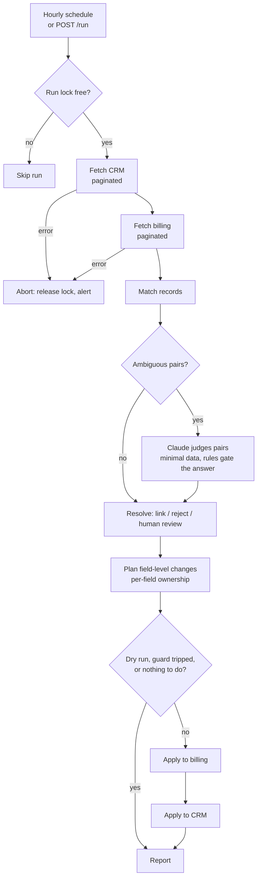

# Customer Reconciliation Engine (n8n + Claude)

An n8n workflow that keeps customer records consistent between two systems, a **CRM** and a **billing platform**, without a shared ID. It matches records, decides which system owns each field, applies only the changes that are needed, and reports what it could not safely decide.

**The business problem:** the same customer exists in two systems with different IDs and slightly different data ("Bob  Smith" and "bob+news@gmail.com" in one place, "Bob Smith" and "bob@gmail.com" in the other). Sales sees the wrong plan, billing sends invoices to old emails, and nobody trusts either system. A naive sync either duplicates records or overwrites good data. This workflow is built so that when it is unsure, it asks a person instead of guessing.

## How it works



**Matching, in order:** a cached confirmed link, an explicit foreign key, normalized email, phone + postal code, then blocked fuzzy scoring (Jaro-Winkler name similarity plus postal, phone and email corroboration). Pairs that score between 0.70 and the auto-link bar become *ambiguous*.

**Field ownership:** the CRM owns name, email, phone and postal code. Billing owns plan and status. Each change flows from the owner to the other system, and the missing link ID is backfilled into the CRM.

## Design decisions

- **Safe by default.** Runs are dry runs unless a run explicitly sends `dryRun: false`. The report shows what *would* change.
- **The model never links records alone.** Claude only sees pairs the rules could not settle, and its answer is one input to a rule: it must say "same" with at least 0.9 confidence *and* the deterministic score must independently be 0.80 or higher. Otherwise the pair goes to a human review queue. Invented pair IDs, malformed answers, duplicate answers and "no tool call" are all ignored.
- **Minimal data to the model.** Names and postal codes only, plus email *domain* and last 4 phone digits. Full emails and phone numbers never leave the workflow.
- **Decisions are remembered.** Confirmed links and human rejections are cached, so each pair is judged once and the model is not called again for settled records. A cached link to a deleted record is ignored.
- **State-based, so it self-heals.** Each run recomputes the diff from current data instead of replaying events. A failed update is simply planned again on the next run. Writes carry a deterministic `Idempotency-Key`, so a retry cannot apply twice.
- **Nothing is overwritten with nothing.** An empty source value never wipes a populated field. Formatting-only differences (`(410) 555-0101` vs `410-555-0101`) are not changes.
- **Blast-radius guard.** If a run would change more than 20% of matched records (minimum 10), it halts and reports. A person must re-run with `force: true` after checking the data. This catches a broken upstream export before it rewrites everything.
- **Failures are isolated.** One failing record does not stop the others; it goes to a dead-letter list (record id, field names, error, never field values).
- **Run lock.** Overlapping runs are skipped, and a crashed run's lock expires after 30 minutes.
- **No personal data in state, reports or alerts.** The review queue, conflicts, dead letter and Slack report contain IDs, scores and counts only.
- **Humans close the loop.** `GET /review` lists pairs needing a decision, conflicts (two CRM records claiming one billing account), and failures. `POST /decide` records a link or reject decision that the next run respects.

### Tradeoffs I chose

- Both systems are fetched in full each run so every record can find its counterpart. That is fine for thousands of records; at larger scale, add `updated_since` filtering backed by the cached link table.
- State (links, review queue, lock, dead letter) lives in n8n workflow static data so it runs with no database. Production should use Postgres or Redis: static data is shared across runs, size-limited, and only persists in production executions.
- The CRM and billing endpoints, field names and the Slack-style webhook are placeholders (`*.example.invalid`). Adapt the field specs in `src/diff.js` and `src/match.js` (`prep`) to your schemas.
- Matching weights are hand-set. With real data, tune them against a labelled sample.

## Setup

1. Import `workflows/customer-reconciliation-engine.json` into n8n.
2. Create Header Auth credentials: `CRM API Key`, `Billing API Key`, `Anthropic API Key` (`x-api-key`), and `Reconciliation Admin Key` for the three admin webhooks.
3. Replace the `example.invalid` URLs in **Fetch CRM**, **Fetch Billing**, **Post Report**, **Post Alert**, and the base URLs in `src/diff.js` (then `npm run build`).
4. Activate the workflow. Try a dry run:

```bash
curl -X POST https://YOUR-HOST/webhook/run -H "X-Admin-Key: ..." -H "Content-Type: application/json" -d '{"dryRun": true}'
```

5. Read the report, check `GET /webhook/review`, and when the plan looks right, send `{"dryRun": false}` (or change `DEFAULT_DRY_RUN` in **Prepare Run**).

## Tests

```bash
npm test   # 31 tests, no dependencies
```

- **Unit tests (15):** SHA-256 vs Node crypto, Jaro-Winkler against published reference values, normalizers, every matching stage, conflicts, diff rules, idempotency keys, and the model-gating policy.
- **Workflow simulation (16):** `tests/sim.js` runs the *generated workflow JSON* node by node against a stateful fake CRM and billing system, with a fake clock. Scenarios: dry-run default, correct field ownership, idempotent second run, human decisions, model outage, a hostile model, prompt injection in a record, the guard, per-record failure and automatic retry, lock behavior, fetch failure, pagination, and a PII scan of every place data is stored or sent.

**What the tests do not prove:** the simulator is not n8n. It does not exercise n8n's pagination and batching engines, expression engine, or credentials, and the model is stubbed, so matching quality on real data is untested. The pagination and batching parameters in the workflow JSON follow n8n's node schema but have not been run in n8n. Import it and run a dry run against real credentials before relying on it.

## Documentation

- [`docs/OPERATING_GUIDE.md`](docs/OPERATING_GUIDE.md): endpoints, run modes, reading the report, troubleshooting
- [`docs/SOP.md`](docs/SOP.md): procedure for the data steward who works the review queue

## Repo layout

```
src/strings.js      normalizers and Jaro-Winkler similarity
src/match.js        multi-stage matching with blocking and conflict detection
src/diff.js         field ownership, diff, idempotency keys, guard limit
src/adjudicate.js   model request and the rules that gate its answer
src/hmac.js         pure-JS SHA-256 (idempotency keys)
scripts/            workflow generator
tests/              unit tests, graph simulator, stateful fake systems, scenarios
workflows/          the importable n8n workflow (generated from src/)
```

Edit `src/`, then run `npm run build` to regenerate the workflow JSON.

## Ideas for next steps

- Incremental fetching with `updated_since` and a webhook-driven fast path for single-record changes.
- Postgres-backed state and an audit table of every change with before/after hashes.
- A labelled evaluation set to tune the match weights and measure precision and recall.
