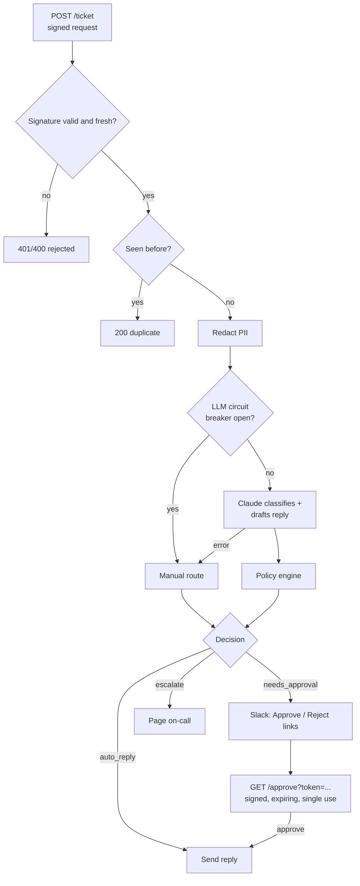

# Support Triage Agent (n8n + Claude)

An n8n workflow that receives customer support tickets, classifies them with Claude, drafts a reply, and then lets **deterministic code decide what the AI is allowed to do on its own**: send the reply, hold it for a human to approve, or escalate to on-call.

**The business problem:** support teams drown in tickets, and a naive "let the AI answer everything" bot will eventually promise a refund it can't give, leak a customer's details, or get talked into something by a hostile message. This workflow gets the speed of AI on routine tickets while keeping people in charge of anything involving money, account access, security, or doubt.

## How it works



Also: `GET /metrics` (header-auth protected) and a weekday **daily digest** with decisions, pending approvals past SLA, LLM usage, and reply failures.

## Design decisions

- **Authenticated intake.** Requests must carry `X-Timestamp` and `X-Signature` (`HMAC-SHA256(secret, timestamp + "." + rawBody)`). Requests older than 5 minutes are refused, which blocks replayed captures. Comparison is constant-time. If the secret is not configured, the workflow fails closed.
- **PII never reaches the model or the logs.** Emails, phone numbers, SSNs, card numbers (Luhn-checked) and record IDs are replaced with placeholders before the LLM call. Only the ticket ID, category, priority and the AI's one-line summary are stored. Extra fields in the payload (like a customer email) are dropped.
- **The model proposes, code decides.** The policy engine (`src/triage.js`) is plain, tested code:
  - Auto-reply only for low-risk categories, confidence of 0.8 or higher, and a draft with no commitments.
  - Billing and account-access tickets always need a human.
  - Any draft mentioning refunds, credits, legal terms, guarantees or dollar amounts is held, **even if the model says it is fine**.
  - Security incidents, p1, and anything the model flags as a prompt-injection attempt go to on-call.
- **Signed approval links.** Approve/reject links contain an HMAC-signed, 24-hour, action-scoped token. Each ticket can be decided once; a second click, a reject-after-approve, a forged or expired token are all refused.
- **Circuit breaker.** After 3 consecutive LLM failures the workflow stops calling the model for 5 minutes and routes tickets straight to humans, so an outage does not stack up timeouts or hide tickets.
- **Nothing fails silently.** Reply delivery failures return 502, are recorded, and show up in metrics and the digest. LLM failures become escalations, not dropped tickets.
- **Portable crypto.** SHA-256 and HMAC are implemented in pure JavaScript (`src/hmac.js`) and tested against Node's `crypto`, so the Code nodes do not depend on built-in modules being enabled.
- **SLA tracking.** Each ticket gets a due time by priority (p1 15 min, p2 1 h, p3 8 h, p4 24 h); pending approvals past their SLA are listed in `/metrics` and the digest.

### Tradeoffs I chose

- State (dedupe, pending approvals, counters, breaker) lives in n8n workflow static data so it runs with no database. Production should use Postgres or Redis: static data is shared by all runs, size-limited, and only persists in production executions.
- Redaction is pattern-based. It will miss names and free-text identifiers, so treat it as a first layer, not a guarantee.
- The reply and notification endpoints are placeholders (`*.example.invalid`) because every helpdesk differs. Swap in your own.
- Confidence scores are the model's self-estimate, a weak signal. The category rules and human approval are what make this safe.

## Setup

1. In n8n, import `workflows/support-triage-agent.json`.
2. Create a **Header Auth** credential `Anthropic API Key` (header `x-api-key`) and attach it to **Claude Classify**.
3. Create a second Header Auth credential `Metrics Access Key` for the **Metrics Webhook** node.
4. Set a long random secret as `TRIAGE_WEBHOOK_SECRET` (an n8n environment variable on self-hosted, or a Variable on plans that have them). Share the same secret with whatever system sends tickets.
5. Replace the four `https://*.example.invalid/...` URLs in **Send Auto Reply**, **Send Approved Reply**, **Notify Approver**, **Notify On-call** and **Post Digest** with your helpdesk API and Slack-style incoming webhooks.
6. Activate the workflow, then send a signed ticket:

```bash
TRIAGE_WEBHOOK_SECRET=your-secret node scripts/send-ticket.js https://YOUR-HOST/webhook/ticket 0
```

`samples/tickets.json` has four tickets, each labeled with the outcome to expect.

## Tests

```bash
npm test   # 41 tests, no dependencies
```

- **Unit tests:** HMAC vs Node crypto, signature/replay/token checks, PII redaction, the circuit breaker, and 18 policy-rule cases.
- **Workflow simulation (`tests/sim.js`):** executes the *generated workflow JSON* node by node (Code, IF, Switch, Respond, stubbed HTTP) with a fake clock, to test routing and the Code nodes together: bad signatures and replays rejected before any model call, PII absent from the Claude request, approval links single-use, breaker opening and recovering, reply failures surfaced, metrics and digest.

**What the tests do not prove:** the simulator is not n8n. It does not exercise n8n's expression engine, credentials, binary-data handling for `rawBody`, or real API behavior, and the model is stubbed, so extraction quality is untested. Import the workflow and run the sample tickets against your real credentials before relying on it.

## Documentation

- [`docs/OPERATING_GUIDE.md`](docs/OPERATING_GUIDE.md): endpoints, responses, monitoring, troubleshooting
- [`docs/SOP.md`](docs/SOP.md): procedure for approvers and on-call

## Repo layout

```
src/hmac.js        pure-JS SHA-256 / HMAC-SHA256
src/security.js    request signature check, approval tokens, payload validation
src/redact.js      PII redaction
src/breaker.js     LLM circuit breaker
src/triage.js      prompt, tool schema, policy engine, metrics
scripts/           workflow generator, signed-request sender
tests/             unit tests, graph simulator, scenario tests
workflows/         the importable n8n workflow (generated from src/)
```

Edit `src/`, then run `npm run build` to regenerate the workflow JSON.

## Ideas for next steps

- Move state to Postgres/Redis and add an audit table.
- Add a retrieval step so drafts cite your knowledge base, with the policy engine still gating sends.
- Name/entity redaction with an NER step, and an evaluation set to measure classification accuracy.
